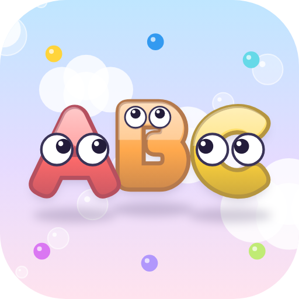
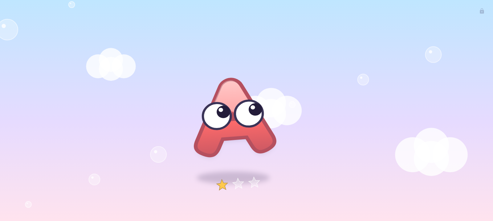
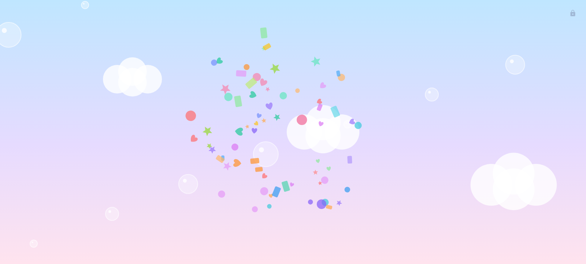
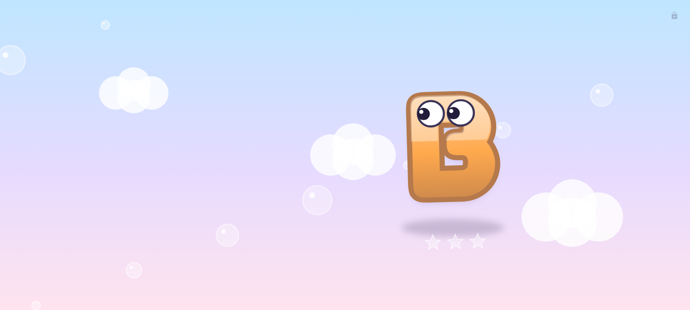
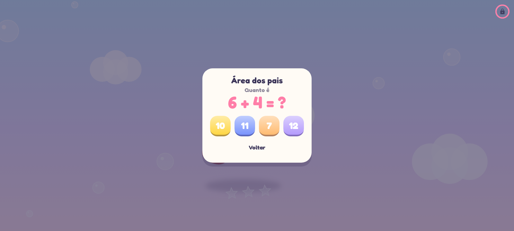

<p align="center">
  
</p>

<h1 align="center">Letrinhas · ABC Kids</h1>

<p align="center">
  
  
  
  
</p>

<p align="center"><b>Um jogo de alfabeto para bebês: letras fofas com olhinhos passeiam, fogem, pulam e explodem em confetes.</b></p>

---

## 📸 Telas

| Letra passeando | 3º toque: explosão |
|:---:|:---:|
|  |  |
| **Próxima letra entrando** | **Área dos pais** |
|  |  |

## 🎈 Como jogar

1. A letra **A** entra andando, piscando e olhando em volta.
2. **Tocou fora da letra?** Ela leva um susto, arregala os olhos e sai correndo para longe do dedo, depois se acalma e volta a passear.
3. **Tocou na letra?** Ela se espreme, faz *boing* e pula para outro canto da tela. Uma estrelinha embaixo dela acende.
4. No **3º toque** certeiro (3 estrelas), a letra **explode em confetes** com um *pop*.
5. Entra a **B**, depois a C… até o Z, e recomeça.

Tela cheia, tela sempre ligada, área de toque generosa, um dedo de cada vez (multitoque é ignorado), botão voltar desativado. **Sem anúncios e sem internet.**

| Fugindo do dedo | Pulando depois do toque |
|:---:|:---:|
|  |  |

## 🔒 Área dos pais

- Cadeado discreto no canto superior direito.
- **Segure 1,5 segundo** (o anel enche). Toques curtos não fazem nada.
- Responda uma **soma simples** (muda a cada vez).
- Menu: **Continuar**, **Música** liga/desliga, **Efeitos** (pop, boing) liga/desliga, **Sair**.

## 🎵 Música e sons

- Música de fundo suave (caixinha de música), em loop, bem baixinha (15%).
- Efeitos sintetizados: *pop* na explosão, *boing* no pulo e um sopro quando a letra foge. A música abaixa um instante em cada efeito.
- A música pausa quando o app vai para segundo plano.
- Todos os áudios ficam dentro do app e são carregados no início, sem atrasos.

## 📌 Fixar o app (Motorola / Android)

Para o bebê não sair do jogo:

1. **Configurações → Segurança → Mais configurações de segurança → Fixar app** (ou busque "Fixar") e ative. Recomendado: "Pedir PIN antes de liberar".
2. Abra o Letrinhas e vá para **apps recentes** (botão quadrado, ou deslize de baixo para cima e segure).
3. Toque no **ícone do app** em cima da janela → **Fixar**.
4. Para soltar: segure **Voltar + Visão geral** juntos (com gestos: deslize para cima e segure) e digite o PIN.

## 📲 Instalar

1. Copie `Letrinhas.apk` para o celular (Android 5.0+, arm64).
2. Abra o arquivo e autorize "instalar apps desconhecidos" se o Android pedir.

## 🛠️ Compilar

```bash
flutter pub get
flutter analyze && flutter test
flutter build apk --release --split-per-abi --target-platform android-arm64
```

- Design system: `lib/theme/design_system.dart` (cores por letra, céu, sombras, curvas, partículas, olhos).
- Telas e logo: `flutter test --update-goldens` (gera `shots/`; copie para `docs/screenshots/`).
- Efeitos: `./gen_audio.sh` (ffmpeg).
- Música: `python3 gen_music.py` e depois ffmpeg para `assets/audio/musica.ogg`.

## 📜 Créditos e licenças

- **Fonte Fredoka**: SIL Open Font License 1.1.
- **Música e efeitos**: 100% sintetizados por código (`gen_music.py` e ffmpeg), sem samples de terceiros.
- **Letras, olhos, confetes, cenário e logo**: desenhados em código (CustomPainter).

© Hélio Rosado Neto. Todos os direitos reservados.
